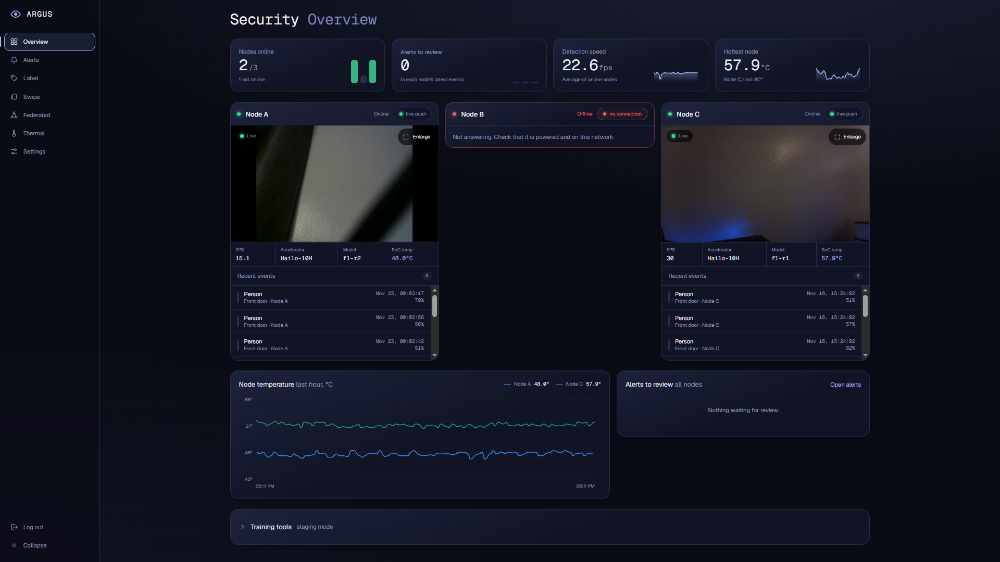
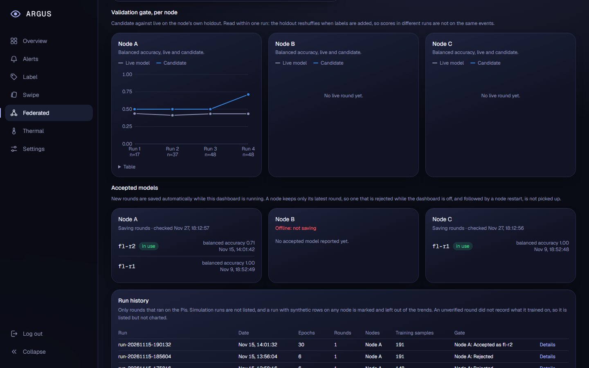
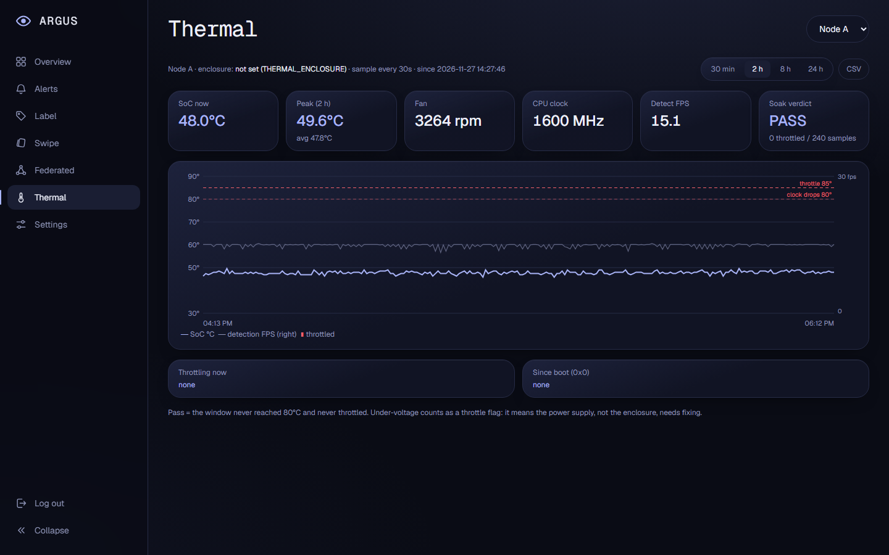
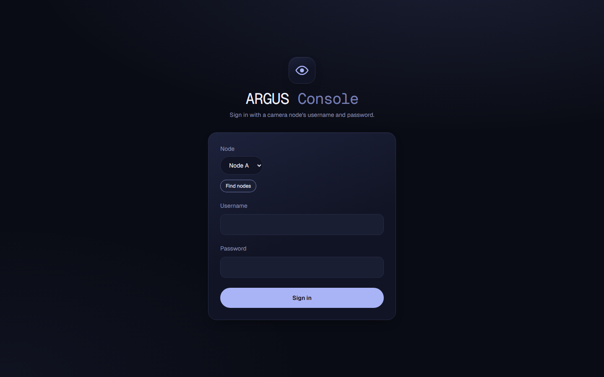
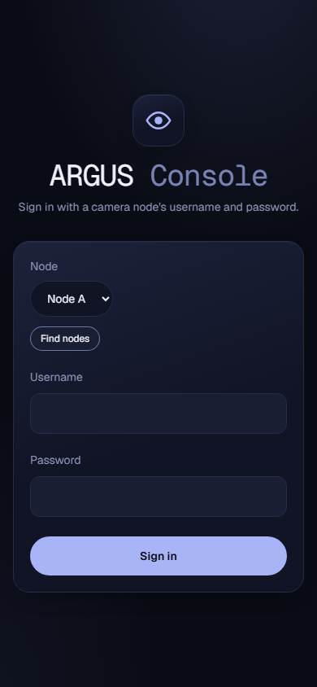
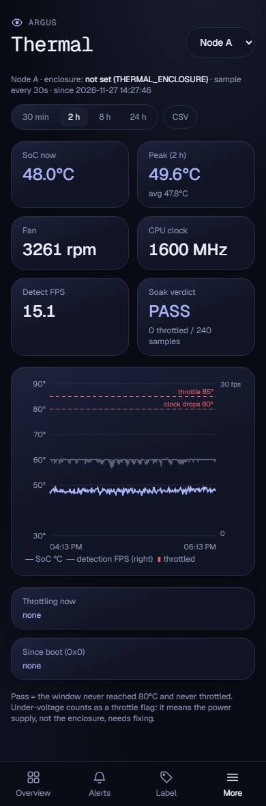
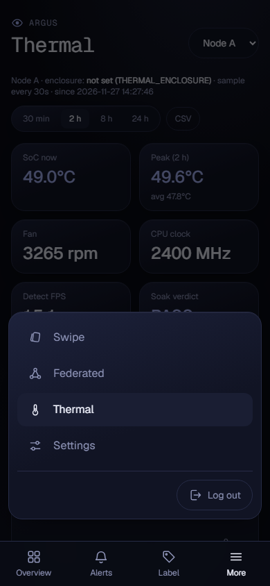
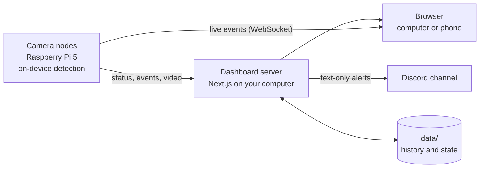

<div align="center">

# 👁️ ARGUS Console

**The dashboard for ARGUS, a distributed AI home security system built on Raspberry Pi camera nodes.**

Watch every camera, review what the AI flags, teach it, and follow its federated training,
from a computer or a phone on your own network.




</div>

---

## ✨ Features

| | |
|---|---|
| 🎥 **Every camera on one screen** | Live video, FPS, accelerator, model version and temperature per node, with an **Enlarge** view |
| 🚨 **Alerts** | Only what a node judged unusual, with confirm and correct |
| 💬 **Discord alerts** | Sent by the server with no browser open. **Text only**: no pictures or video |
| 🔎 **Finds the nodes itself** | Searches the local network and matches each node by name, so new networks need no editing |
| 🧠 **Federated learning** | Rounds are saved automatically, with run history, validation charts and accepted models |
| 🏷️ **Labeling** | A review queue, a phone swipe game and a staging mode for acted-out events |
| 🌡️ **Thermal** | Temperature, throttling and fan history, with CSV export |
| 🔐 **Sign-in** | Checked by the node, then kept in a signed cookie that cannot be forged |
| 📱 **Phone ready** | Bottom navigation bar and layouts made for small screens |

## 📸 Screenshots

<table>
  <tr>
    <td width="50%"><br><sub><b>Federated learning</b></sub></td>
    <td width="50%"><br><sub><b>Thermal monitoring</b></sub></td>
  </tr>
  <tr>
    <td colspan="2" align="center"><br><sub><b>Sign in</b></sub></td>
  </tr>
</table>

<div align="center">
  
  
  
</div>

## 🧩 How it fits together



Detection runs on the nodes. The dashboard never starts a training round and never changes a model.

## 🚀 Quick start

**You need:** [Node.js](https://nodejs.org) **22.18 or newer**, and a computer on the **same network** as the camera nodes.

```bash
git clone https://github.com/adam9798/argus-dashboard.git
cd argus-dashboard
npm install
cp .env.local.example .env.local     # Windows: copy .env.local.example .env.local
npm run dev
```

Open **http://localhost:3000** and sign in with a node's username and password.

In `.env.local`:

1. Set `ARGUS_NODES` to your node names, as each node reports them (`Node A`, `Node B`, …).
   The addresses may be out of date; the dashboard finds the real ones.
2. For Discord alerts, add `ARGUS_DISCORD_WEBHOOK_URL`. Ask whoever runs the channel.

> **Keep `.env.local` private.** It is ignored by git. Anyone with the webhook address can post to your channel.

### Production mode

Use this for daily running and demos. It is faster, and needs a rebuild after code changes.

```bash
npm run build
npm run start
```

### Open it on a phone or another computer

1. Start with `npm run dev -- -H 0.0.0.0` (or `npm run start -- -H 0.0.0.0`).
2. Browse to `http://<this-computer's-IP>:3000`.
3. On Windows, allow the port once, in an administrator PowerShell, on a **private** network only:

```powershell
New-NetFirewallRule -DisplayName "ARGUS dashboard" -Direction Inbound -Protocol TCP -LocalPort 3000 -Action Allow -Profile Private -RemoteAddress LocalSubnet
```

Restart the dashboard after moving to another network.

## ⚙️ Settings

All optional except where noted. See [`.env.local.example`](.env.local.example).

| Variable | Purpose |
|---|---|
| `ARGUS_NODES` | `Name=URL`, comma separated. Signing in to a **listed** name opens the console |
| `ARGUS_DISCORD_WEBHOOK_URL` | Where alerts are sent. Unset turns alerts off |
| `ARGUS_DASHBOARD_URL` | Link used in alerts. Defaults to this computer's current address |
| `ARGUS_ALERT_USER`, `ARGUS_ALERT_PASS` | A node sign-in for background alerts and round saving, if nodes require one |
| `ARGUS_FLOWER_API` | The federated aggregator's REST address. Default `http://localhost:8090` |
| `ARGUS_DISCOVERY=off` | Stops the automatic network search (the **Find nodes** button still works) |
| `ARGUS_FL_SAVER=off` | Stops automatic saving of training rounds |
| `ARGUS_NODE_PORT` | The nodes' API port. Default `8000` |
| `ARGUS_SESSION_SECRET` | Cookie signing key. Made automatically if unset |
| `AUTH_COOKIE_SECURE` | `true` only when served over HTTPS |
| `ARGUS_FL_DATA_DIR`, `ARGUS_SWIPE_DATA_DIR`, `ARGUS_ALERTS_DATA_DIR`, `ARGUS_NODES_FILE`, `ARGUS_SESSION_SECRET_FILE` | Move saved data elsewhere |
| `NEXT_PUBLIC_API_BASE_URL`, `NEXT_PUBLIC_WS_EVENTS_URL` | Fallbacks for a single node when `ARGUS_NODES` is unset |

## 💾 Your data

Everything the dashboard saves is in `data/` on the computer that runs it, and is ignored by git:
training history, swipe records, alert state, found node addresses and the signing key.
Copy that folder to move to another computer.

**One dashboard per webhook:** two running at once send every alert twice.

### Import older training rounds

A node reports only its latest round since it started. To bring in earlier ones:

```bash
ssh <user>@<node> 'cd argus && python3 -' < scripts/collect-fl-rounds.py > node.json
# stop the dashboard, then:
node scripts/import-fl-rounds.mjs node.json
```

## 🧪 Working without hardware

`npm run mock-backend` starts a fake node on port 8000 that accepts any sign-in. Comment out
`ARGUS_NODES`, set `NEXT_PUBLIC_API_BASE_URL=http://localhost:8000` and `ARGUS_DISCOVERY=off`.
It has no camera, and **its data is invented**: never present it as real.

## 🗂️ Project layout

```
app/
  login/              sign-in
  dashboard/          overview, alerts, label, swipe, federated, thermal, settings
  api/argus/          server-side proxy to the nodes (allow-listed paths only)
  api/auth|fl|swipe|alerts|discovery/
components/           shell, overview, node panels, labeling, federated, swipe
hooks/                live feed, node health, node list
lib/
  session.ts          signed session cookies
  discovery/          network search
  alerts/             Discord watcher, retries, dead-letter log
  fl/                 round saver, merge rules, history store
  swipe/              swipe and staging records
instrumentation.ts    starts the background services
proxy.ts              page guard
scripts/              mock node, round import
```

## 🔌 What a node must provide

`POST /api/login` · `GET /api/status` · `GET /api/events` · `POST /api/events/{id}/label` ·
`WS /ws/events` · `GET /api/camera/stream` · `GET /api/system/thermal[/history]` ·
`GET /api/federated/{samples,round,head,head/versions,suggestions,scores}`

## ⚠️ Good to know

- The dashboard is built for a **home network over plain HTTP**. Do not expose it to the internet.
- Its sign-in protects the dashboard. **Each camera node must be secured on its own.**
- Node search trusts the names nodes report, so run it on networks you trust.
- Alerts arrive within a few seconds, while the dashboard computer is on and can reach the nodes and the internet.
- A training round that is **rejected** while the dashboard is off, followed by a node restart, is not saved automatically.

See [CHANGES.md](CHANGES.md) for what changed in this version.
